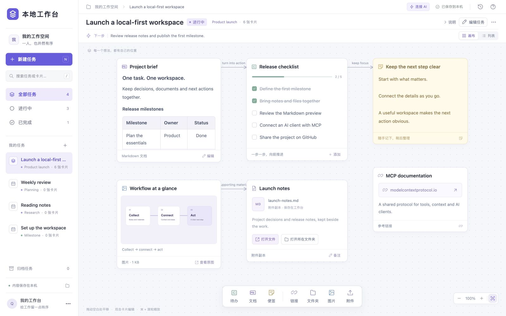
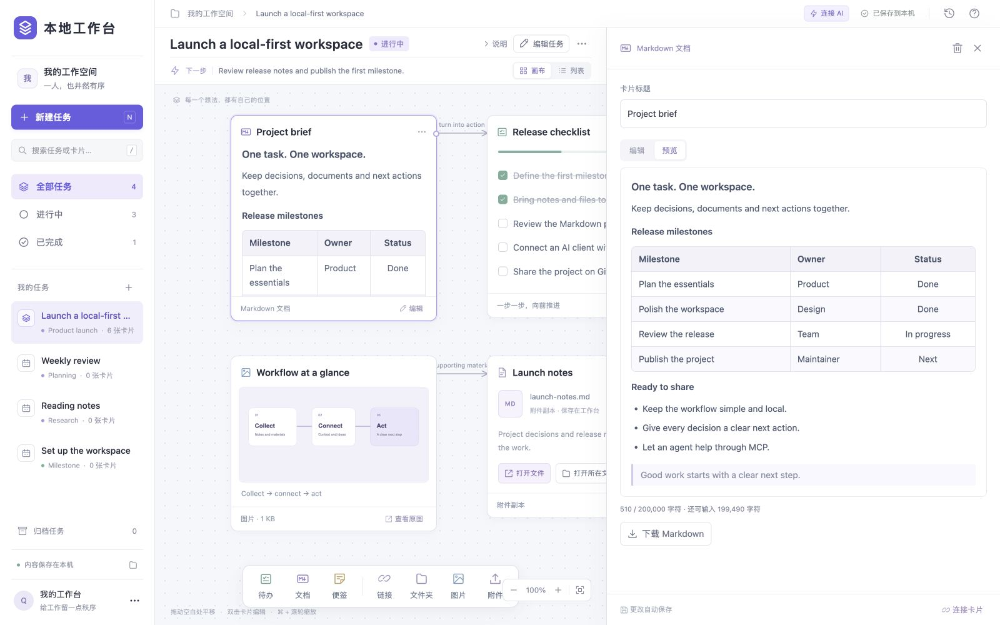
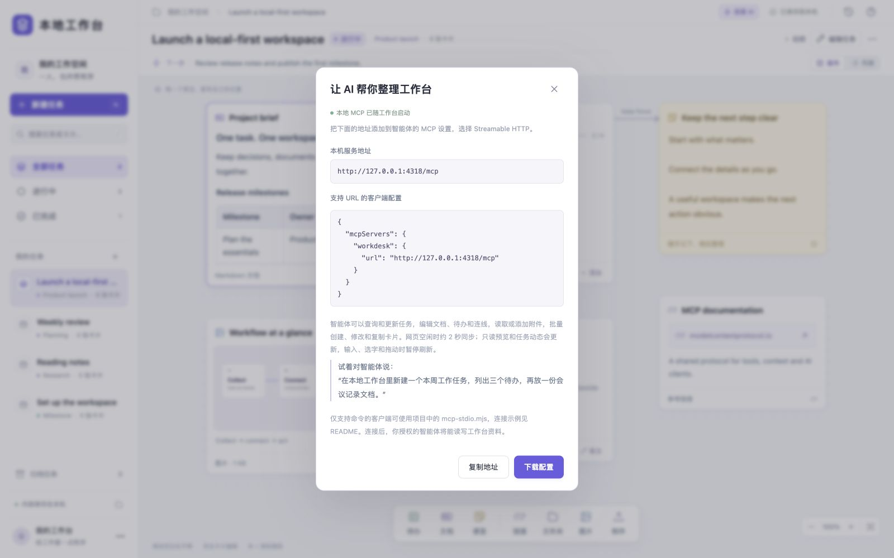

English | [简体中文](README.zh-CN.md)

# Workdesk

A local-first task workspace for people and AI agents. Give each task its own canvas, organize documents and materials as cards, and let an external AI client read and update the workspace through the Model Context Protocol (MCP).

Workdesk runs as a local Node.js service with a browser interface. It does not include a model or require a Workdesk account.

Screenshots show Workdesk running locally with fictional English sample content. The interface is currently in Simplified Chinese.



*Task canvas with documents, to-dos and reference materials.*

## Features

- **A canvas for each task:** track goals, next actions, status and activity; search, archive and restore tasks; switch between canvas and list views.
- **Six card types:** to-do lists, Markdown documents, notes, links, images and files. Link cards can also reference local folders; file cards can reference original local files.
- **Direct manipulation:** drag cards, pan and zoom the canvas, and connect cards with labeled relationships. Resize the right-hand inspector by dragging its left edge; its width is remembered in the browser.
- **Markdown editing and preview:** headings, lists, bold text, quotes, fenced code, links and tables, including column alignment and horizontal scrolling. Download documents as `.md` files.
- **Materials alongside your work:** drag in files, paste screenshots, and open or reveal files through Windows Explorer or macOS Finder.
- **Shared work with agents:** 16 MCP tools cover tasks, cards, to-dos, connections and attachments, with pagination, revision checks and atomic card batches.
- **Local persistence:** automatic incremental saves, Markdown copies on disk and JSON backup export. Read-only previews and activity panels receive agent updates while preserving scroll position.

Connections express relationships; they do not execute scripts or run workflows.

## Quick start

Install **Node.js 22 or later**, including npm, then run:

```sh
git clone https://github.com/msly5/workdesk.git
cd workdesk
npm ci
npm start
```

Open **http://127.0.0.1:4317**. Keep the terminal open and press **Ctrl+C** there to stop the service. Dependency installation requires internet access; the workspace can run offline afterward.

For a background service, use the included launchers instead:

| Platform | Start | Stop |
| --- | --- | --- |
| Windows | Double-click `start.cmd` | Double-click `stop.cmd` |
| macOS | Double-click `start.command` | Double-click `stop.command` |

The launchers check Node.js, install missing dependencies and open the browser. Closing the browser does not stop the background service. This is a browser-based application, not a native macOS `.app`.

On macOS, if a ZIP download loses script permissions, run `chmod +x start.command stop.command` in the project directory. You can also run `bash start.command` from a terminal configured with Node.js. Standard Node.js and common Homebrew paths are supported; custom environments such as nvm may need that terminal route.

The macOS launcher only reuses the service recorded for this project directory. If the port is occupied, stop the other service or choose another port, for example `WORKDESK_PORT=4318 ./start.command`. Use Ctrl+C to stop a service started with `npm start`; the stop launcher only stops the matching service it manages. Startup diagnostics appear in the launcher window, `install.log` and `server-error.log`.

## Using the workspace

Create a task in the left sidebar and add cards from the bottom toolbar. Double-click a card to open its inspector. Click a card's connection handle, then another card, to link them; click the line to edit its label or remove it. To-dos can be checked directly on the canvas.

Drag empty canvas space to pan, scroll to move, and use **Ctrl+scroll** to zoom; macOS also supports **Cmd+scroll**. Use the fit-content button to bring cards into view. **Ctrl+S / Cmd+S** saves immediately, and **Ctrl+V / Cmd+V** pastes a screenshot when you are not editing a text field.



*Markdown table preview in the resizable inspector.*

### File copies and local references

**Import attachment copy** and drag-and-drop copy files into Workdesk's `data` directory. Opening one of these cards edits the Workdesk copy. Later downloads and backups read that same copy, including external edits.

**Add local file** records an absolute path without copying the file. Opening it edits the original. Folder cards likewise record a directory path without copying its contents. Update these paths if files move or you migrate to another computer. On macOS, select a file or folder in Finder and press **Option+Cmd+C** to copy its path.

Both attachment and local-file cards can open a file with its default application or reveal it in Explorer/Finder. Program, script and installer types blocked from direct opening can be inspected through **Open containing folder** instead. Older extensionless attachments are preserved; the first open/reveal operation creates a named copy used by subsequent opens, downloads and backups.

### Limits and saving

| Item | Limit |
| --- | --- |
| Card body | 200,000 characters, measured as JavaScript string length |
| Browser attachment upload | 25 MiB per file |
| MCP attachment upload | 4 MiB per file |
| MCP attachment read | 256 KiB by default; up to 4 MiB per request |
| MCP task/card list | 50 entries by default; up to 100 per page |
| Atomic card batch | 100 operations and 2 MiB of arguments |

The editor shows remaining body capacity. An oversized paste is rejected as a whole with an explanation, rather than silently truncated. An oversized input-method draft remains in the page and can be downloaded in full; shorten it to resume saving. Some emoji count as two characters toward the limit.

The browser checks for revisions about every two seconds while idle and fetches the workspace only when it changes. Read-only Markdown previews and activity panels update automatically. Editing, text selection, input-method composition, dialogs and dragging pause refreshes to protect your interaction.

Changes to independent fields can merge. Concurrent changes to the same field produce a conflict instead of silently overwriting either version. The save indicator offers a page backup before loading the latest state. Unsaved changes also trigger a browser warning when closing the page. Markdown copies are rewritten only when their content changes, not when you pan the canvas or rename a task.

## Connect an AI client

Start Workdesk first. The **Connect AI** button provides the local endpoint, example configuration and a configuration download. These examples do not automatically configure your AI client.



*Local MCP endpoint and client configuration. The screenshot uses a separate demo instance on port 4318; the default is 4317, as shown below.*

### Streamable HTTP

Use **`http://127.0.0.1:4317/mcp`** with a client that supports Streamable HTTP:

```json
{
  "mcpServers": {
    "workdesk": {
      "url": "http://127.0.0.1:4317/mcp"
    }
  }
}
```

See [mcp-config.json](mcp-config.json). Client formats vary: some require `"type": "http"` or a transport selection in their settings.

### stdio bridge

For a client that launches MCP servers as commands:

```json
{
  "mcpServers": {
    "workdesk": {
      "command": "node",
      "args": ["/absolute/path/to/workdesk/mcp-stdio.mjs"]
    }
  }
}
```

On Windows, use an absolute path such as `C:/path/to/workdesk/mcp-stdio.mjs`. See [mcp-stdio-config.json](mcp-stdio-config.json). If the client cannot find `node`, set `command` to the executable's absolute path.

Both transports require the workspace service to be running. The stdio entry point bridges to that same HTTP service; it does not start a second data store. After changing ports, update the HTTP URL or set `WORKDESK_MCP_URL` in the stdio client's environment, for example `http://127.0.0.1:4318/mcp`. Update the script path if the project moves.

Try asking your agent: “Create a task for this week's work, add a meeting-notes document and a to-do list with three actions.” Or: “Read the notes in this task, add today's progress and check off the completed actions.”

### MCP coverage

| Tools | Purpose |
| --- | --- |
| `list_tasks`, `get_task` | Search tasks and read a complete task canvas |
| `create_task`, `update_task` | Create tasks; update titles, goals, next actions and status; archive or restore |
| `list_cards`, `get_card` | Search and paginate card summaries; read complete card content |
| `create_card`, `update_card`, `delete_card` | Manage card content, properties and positions; remove cards and their connections |
| `batch_cards` | Atomically create, update, delete or duplicate cards within one task |
| `set_todo_item`, `remove_todo_item` | Add, edit, check or remove individual to-do items |
| `connect_cards`, `delete_connection` | Create or relabel connections, or remove them |
| `attach_file` | Upload base64-encoded bytes and add an attachment/image card |
| `read_attachment` | Read an uploaded attachment in bounded chunks |

There are **16 tools, one fixed resource and two resource templates**:

| Resource or template | Content |
| --- | --- |
| `workdesk://tasks` | First 50 unarchived tasks |
| `workdesk://tasks/{taskId}` | Complete task, cards and connections |
| `workdesk://tasks/pages/{offset}/{limit}` | Paginated unarchived tasks |

List tools return `total`, `has_more` and `next_offset`. Task-list resources provide `next_uri` when another page exists. Use the list tools for search and status/type filters.

Tools return the current `revision`. Pass it as `expected_revision` when writing to reject stale changes, then reread if it no longer matches. Writes share one persistence queue. `update_card.content` replaces the whole body, so read the latest card before editing; omitted fields are preserved. Tasks are archived rather than permanently deleted. Removing a card returns its removed card and connection data, while retaining attachment files.

`batch_cards` runs operations in order and saves nothing if any operation fails. A successful batch advances the revision once. Give a `create` or `duplicate` operation a `ref` and use `card_ref` to address it later in the same batch; use `card_id` for an existing card. Duplicating keeps attachment references within the same task and generates fresh to-do IDs; it does not copy connections.

```json
{
  "task_id": "your-task-id",
  "expected_revision": 12,
  "operations": [
    {
      "operation": "create",
      "type": "markdown",
      "title": "Meeting notes",
      "content": "# Meeting notes",
      "ref": "minutes"
    },
    { "operation": "update", "card_ref": "minutes", "x": 50, "y": 60 },
    {
      "operation": "create",
      "type": "todo",
      "title": "Follow-up actions",
      "items": [{ "text": "Summarize decisions", "done": false }]
    }
  ]
}
```

`read_attachment` requires `task_id` and `asset_id`. It returns `base64`, `offset`, `next_offset`, `total_bytes` and `has_more`; use the returned `next_offset` for the next chunk. UTF-8 text also receives a `text` field when the chunk contains valid text, with sequential reads accounting for character boundaries. A complete supported PNG, JPEG, GIF, WebP or AVIF image also returns MCP image content. PDF and Office files are returned as bytes, without text extraction.

Local references use `file_path` on a `file` card or `folder_path` on a `link` card. `file_path` is mutually exclusive with `asset_id`; `folder_path` is mutually exclusive with `url`. MCP only stores these path references: it does not read, open or validate the original files or directories. `read_attachment` reads uploaded Workdesk attachments, not arbitrary paths or `file_path` references. File opening happens when a person clicks the corresponding browser action.

## Data, privacy and backups

Workdesk listens on `127.0.0.1`, serves its interface locally and stores workspace data in the project's **`data`** directory. It does not require an account or API key and does not include model calls. Its interface does not load hosted fonts, images or scripts.

**Connecting an external AI client changes the data boundary.** That client can read and modify workspace content through MCP. Content an agent reads is provided to the client and may be sent to its AI service provider, depending on the client's configuration. Only connect clients you trust with that content. MCP does not expose arbitrary local-file reads or system-command execution.

| Path under `data/` | Contents |
| --- | --- |
| `state.json` | Tasks, cards, connections and canvas positions |
| `state.backup.json` | State from the previous save, not a full version history |
| `files/` and `files.json` | Attachment bytes and their index |
| `tasks/<task-id>/docs/` | Markdown copies maintained by Workdesk |

New attachment names preserve extensions as `<attachment-id>--<filename>`; older extensionless files remain supported. Edit Markdown through the browser or MCP: the `.md` files are exported copies, and edits made directly to them are not imported into the canvas. Removing a card or archiving a task does not delete stored attachments.

To back up or migrate, **stop the service and copy the entire `data` directory**. The workspace menu also exports a JSON backup containing workspace state and copied attachments. **There is currently no JSON import interface**, so keep the original data directory. Local-file references contain paths only: neither a data-directory copy nor a JSON export includes those original files or folder contents.

## Development and platform support

```sh
npm test
```

Tests cover persistence, task isolation, incremental saves and conflicts, rollback, conditional Markdown writes, attachment round trips and UTF-8 chunks, atomic batches, pagination, local-access protections, and HTTP/stdio MCP clients. macOS launcher tests use temporary directories to check start, reuse, stop and process identity. File-opening tests stub the OS boundary rather than launching desktop applications.

Windows and macOS have launcher and Explorer/Finder integrations. Tests that require a particular OS are skipped elsewhere; a passing macOS suite does not establish Windows runtime compatibility. Linux does not have the provided desktop file/folder-opening integration or launchers, and is not claimed as a fully validated platform. Windows PowerShell scripts target the built-in PowerShell 5.1; preserve their UTF-8 BOM when editing them.

## License

Workdesk is available under the [MIT License](LICENSE). Dependencies and other third-party components retain their own licenses; see [THIRD_PARTY_NOTICES.md](THIRD_PARTY_NOTICES.md).
