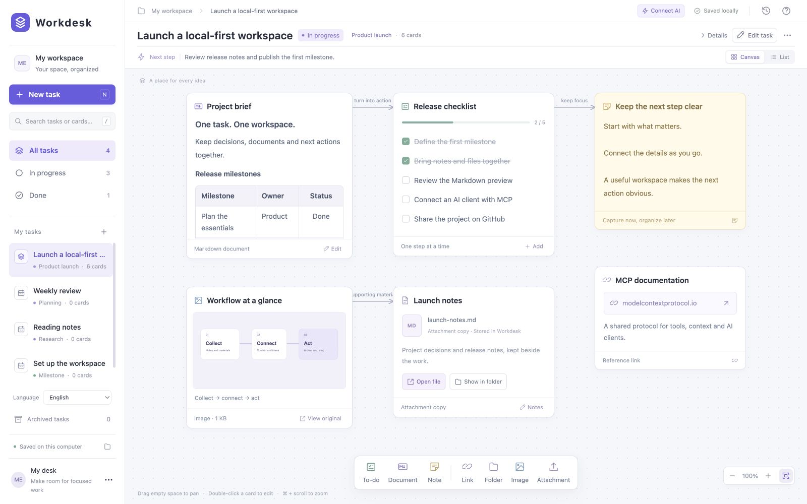
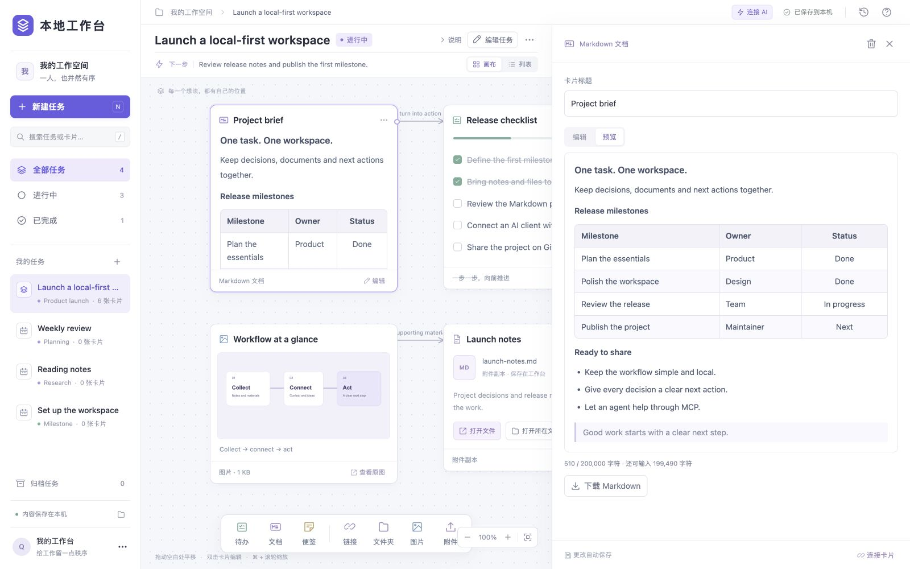
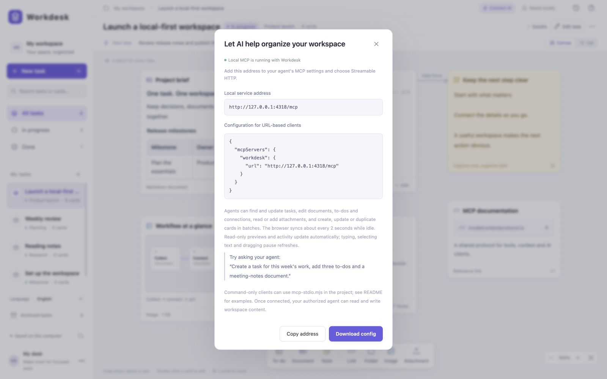

[English](README.md) | 简体中文

# Workdesk

每件任务一张本地桌面。人与 AI 通过 MCP 共同整理文档、待办和附件，把目标、资料与下一步行动放在一起。

Workdesk 是运行在本机的轻量网页应用：Node.js 提供本地服务，浏览器提供画布和编辑器，数据保存在项目目录。无需注册账号，也不需要安装原生桌面应用。AI 能力来自你连接的外部 MCP 客户端，应用本身不内置模型。

应用界面完整支持 **简体中文和英文**，覆盖按钮、菜单、弹窗、帮助和状态提示。首次访问会跟随浏览器语言；左侧栏底部的语言选择器可随时切换，并在当前浏览器记住选择。切换语言会保留已有任务和文档内容。

以下为英文模式的真实截图，使用虚构的演示资料。



*任务画布：把文档、待办和参考资料放在一起。*

## 快速开始

先安装 **Node.js 22 或更新版本**，并确认安装中包含 npm。

```sh
git clone https://github.com/msly5/workdesk.git
cd workdesk
npm ci
npm start
```

打开 **http://127.0.0.1:4317**。通过 `npm start` 启动时，服务在当前终端运行；按 `Ctrl + C` 停止。

macOS 和 Windows 也提供双击启动方式：

| 系统 | 启动后台服务 | 停止后台服务 |
| --- | --- | --- |
| macOS | `start.command` | `stop.command` |
| Windows | `start.cmd` | `stop.cmd` |

启动器会检查 Node.js 版本，在缺少依赖时安装依赖，并打开浏览器。首次安装依赖需要联网；依赖安装完成后，工作台的本地功能可以离线使用。关闭网页不会停止启动器创建的后台服务。

macOS 启动器会查找 Node.js 标准安装和 Homebrew 常用路径。如果使用 nvm 等自定义安装，在已配置 Node.js 的终端运行 `./start.command`。下载 ZIP 后若脚本没有执行权限，可运行：

```sh
chmod +x start.command stop.command
./start.command
```

若系统首次阻止双击脚本，可在终端运行 `bash start.command`。`stop.command` 只停止本目录启动器记录且身份匹配的服务；手动运行的 `npm start` 仍应在原终端停止。

macOS 启动器只复用本目录记录的后台服务。端口被其他进程占用时，先停止原服务，或指定另一个端口：

```sh
WORKDESK_PORT=4318 ./start.command
```

启动失败时查看窗口中的提示、依赖安装日志 `install.log` 和服务错误日志 `server-error.log`。Windows 启动器使用系统自带的 Windows PowerShell 5.1；修改 `.ps1` 文件时请保留 UTF-8 with BOM 编码。

## 在一张桌面上工作

- **按任务组织**：每个任务拥有独立画布、目标、下一步行动和状态，支持归档及恢复。
- **六类卡片**：Markdown 文档、待办、便签、链接、图片和文件；可拖动、复制和建立带说明的关联。
- **文档与行动**：Markdown 支持表格、编辑、预览及下载；待办可直接勾选。
- **画布与列表**：两种视图共享内容，搜索覆盖任务、卡片正文和待办文字。
- **文件与截图**：拖入附件副本，或粘贴剪贴板截图；也可只保存本机文件或目录的路径引用。
- **可调编辑栏**：拖动右侧栏左边缘调整宽度，浏览器会记住设置。
- **自动保存与协作**：网页和 MCP 使用同一份工作区，支持增量保存、版本检查和冲突提示。



*在可调整宽度的右侧栏中预览 Markdown 表格。*

双击卡片打开编辑器。拖动空白区域平移，滚轮移动画布，`Ctrl + 滚轮` 缩放；macOS 也支持 `Cmd + 滚轮`。右下角可适应全部内容。`Ctrl + S` 或 macOS 的 `Cmd + S` 立即保存。

按住卡片右侧连接点，拖到另一张卡片后松开即可连线。拖动时显示预览线并高亮目标；松到空白处或按 Esc 取消。点击连线可修改说明或移除。连线表达资料或行动之间的关系，不执行脚本或自动化流程。

每张卡片正文最多 **200,000 个字符**。超限粘贴会整次拒绝并提示；输入法产生的超限草稿保留在页面，可下载完整正文，缩短后继续保存。

## 附件副本与本地引用

| 方式 | 保存什么 | 打开后编辑什么 | 备份包含什么 |
| --- | --- | --- | --- |
| 导入、拖入或粘贴附件 | 复制到工作台 `data/files` | 工作台中的附件副本 | 附件字节和索引 |
| 添加本地文件 | 原文件的完整路径 | 原文件 | 路径引用 |
| 添加本地文件夹 | 原目录的完整路径 | 在系统文件管理器中打开目录 | 路径引用 |

网页导入的单个附件最大 **25 MiB**，界面显示为 25 MB。附件和本地文件卡片提供“打开文件”“打开所在文件夹”；macOS 使用 Finder，Windows 使用资源管理器。程序、脚本、安装包和 macOS 可执行文件需要通过所在文件夹自行查看。

目录及文件路径支持中文和空格。macOS 示例为 `/Users/your-name/Documents/项目资料`，Windows 示例为 `D:\项目资料`。macOS 可在 Finder 选中文件或文件夹后按 `⌥⌘C` 复制完整路径。移动、删除原文件或换一台电脑后，需要更新相应引用。

旧版无扩展名附件在首次打开或定位时会生成带扩展名的可打开副本，并保留原存储文件。之后打开、下载和备份都读取该副本，外部编辑不会因再次打开而被覆盖。

## 保存、同步与备份

所有工作区数据保存在项目目录下的 `data` 文件夹：

| 路径 | 内容 |
| --- | --- |
| `state.json` | 任务、卡片、待办、连线、画布位置及活动记录 |
| `state.backup.json` | 上一次保存的状态快照，不是完整版本历史 |
| `files/`、`files.json` | 附件字节和索引；新附件保留文件扩展名 |
| `tasks/<task-id>/docs/` | Markdown 卡片同步写出的 `.md` 副本 |

请在网页内或通过 MCP 编辑 Markdown。磁盘上的 `.md` 是导出副本，外部修改不会自动同步回画布。只有正文变化时才会重写对应副本。移除卡片或归档任务不会清理附件文件。

网页只提交发生变化的字段。空闲时约每 2 秒检查版本，有变化才读取完整工作区；只读 Markdown 预览和任务动态会更新并保留滚动位置。正在编辑、选择文字、使用输入法、操作对话框或拖动时暂停自动刷新。

不同字段的并发修改可自动合并。同一字段发生冲突时，页面输入和服务端内容分别保留；点击顶部状态，可导出页面备份后载入最新内容。保存失败会显示提示并允许重试，存在未保存内容时关闭页面会提示。

备份或迁移前先停止服务，再复制整个 `data` 文件夹。迁移项目时无需复制 `node_modules`，在新位置运行 `npm ci` 即可重新安装依赖。左下角菜单也可导出包含附件的 JSON 备份，**目前没有 JSON 导入界面**，请同时保留原始 `data` 文件夹。本地文件和目录引用的备份只保存路径，不包含被引用的原文件。

## 连接 AI：MCP

MCP 服务随工作台一同启动。网页的“连接 AI”入口提供地址、配置下载和示例。请将配置添加到你使用的 MCP 客户端；示例文件不会自动修改客户端设置。



*本地 MCP 地址与客户端连接配置。截图使用独立演示实例的 4318 端口；默认端口为 4317，请参考下方配置。*

### Streamable HTTP

默认地址为 `http://127.0.0.1:4317/mcp`。支持 URL 的客户端可参考 [mcp-config.json](mcp-config.json)：

```json
{
  "mcpServers": {
    "workdesk": {
      "url": "http://127.0.0.1:4317/mcp"
    }
  }
}
```

部分客户端还需要填写 `type: "http"`，或在界面中选择 Streamable HTTP。具体格式以该客户端要求为准。

### stdio

只支持命令启动的客户端可参考 [mcp-stdio-config.json](mcp-stdio-config.json)，将路径换成实际项目位置：

```json
{
  "mcpServers": {
    "workdesk": {
      "command": "node",
      "args": ["/absolute/path/to/workdesk/mcp-stdio.mjs"]
    }
  }
}
```

例如 macOS 项目路径可以是 `/Users/your-name/Projects/workdesk/mcp-stdio.mjs`。如果客户端找不到 `node`，将 `command` 改为本机 Node.js 的完整路径。

**两种传输方式都需要先启动工作台。** stdio 入口桥接同一个 HTTP 服务，不另起一份数据存储。更改端口后更新 HTTP URL；stdio 可在客户端环境变量中设置 `WORKDESK_MCP_URL=http://127.0.0.1:4318/mcp`。迁移目录后更新 `args` 中的路径。

可以这样开始：

> 在 Workdesk 中创建“本周工作”任务，放一份会议记录文档，列出三个待办，并把文档与待办关联起来。

### 工具与资源

目前提供 **16 个工具**：

| 工具 | 用途 |
| --- | --- |
| `list_tasks` / `get_task` | 分页搜索任务，读取完整画布和活动记录 |
| `create_task` / `update_task` | 创建任务，更新名称、标签、目标、下一步及状态，归档或恢复 |
| `list_cards` / `get_card` | 分页搜索卡片，读取完整内容及附件元信息 |
| `create_card` / `update_card` / `delete_card` | 新建、修改或移除卡片，调整坐标及宽度 |
| `batch_cards` | 原子批量新建、修改、删除或复制卡片 |
| `set_todo_item` / `remove_todo_item` | 新增、修改、勾选或移除待办事项 |
| `connect_cards` / `delete_connection` | 建立、更新或移除卡片关联 |
| `attach_file` | base64 上传附件并创建卡片，单次最大 4 MiB |
| `read_attachment` | 有界读取所属任务的附件，返回文本、图片或二进制分块 |

只读资源包括：

- `workdesk://tasks`：未归档任务的前 50 条，有后续页时返回 `next_uri`。
- `workdesk://tasks/{taskId}`：一个任务的完整内容。
- `workdesk://tasks/pages/{offset}/{limit}`：未归档任务分页，每页最多 100 条。

`list_tasks` 和 `list_cards` 返回 `total`、`has_more`、`next_offset`，默认每页 50 条，最多 100 条。卡片搜索涵盖待办文字、链接和文件信息；按任务状态筛选或搜索时使用列表工具。

工具返回当前 `revision`。写入时可传 `expected_revision`；版本已变化时拒绝写入，重新读取后再修改。写入在同一队列中串行持久化。MCP 附件上传与卡片创建一起提交，失败时清理本次新增附件。移除卡片会返回卡片及关联连线，保留附件字节。

### 批量卡片操作

`batch_cards` 在同一个任务内依次执行 `create`、`update`、`delete`、`duplicate`，最多 100 项，参数合计最多 2 MiB。任意一项无效，整批不保存；成功仅增加一次版本。

已有卡片使用 `card_id`。`create` 和 `duplicate` 可设置 `ref`，后续操作使用 `card_ref` 引用。复制保留同任务附件引用并生成新的待办项 ID，不复制连线。下面的任务 ID 和版本号需要替换为读取到的实际值：

```json
{
  "task_id": "your-task-id",
  "expected_revision": 12,
  "operations": [
    {
      "operation": "create",
      "type": "markdown",
      "title": "会议记录",
      "content": "# 会议记录",
      "ref": "minutes"
    },
    { "operation": "update", "card_ref": "minutes", "x": 50, "y": 60 },
    {
      "operation": "create",
      "type": "todo",
      "title": "会后行动",
      "items": [{ "text": "整理结论", "done": false }]
    }
  ]
}
```

### 读取附件与保存路径引用

`read_attachment` 使用 `task_id` 和 `asset_id`。默认读取 256 KiB，`limit` 范围为 4 字节至 4 MiB。每次返回 `base64`、`offset`、`next_offset`、`total_bytes`、`has_more`；后续请求将 `offset` 设为上次返回的 `next_offset`。

UTF-8 文本额外返回 `text`，顺序读取会尽量保持中文及 emoji 字符完整。完整的 PNG、JPEG、GIF、WebP、AVIF 另返回 MCP 图片内容；较大的图片可提高 `limit`，或按块读取字节。PDF、Office 等文件返回原始字节，不提取正文。工具不会读取 `file_path` 指向的本地原文件。

`create_card` / `update_card` 支持两种路径引用：

- `type: "file"` 配合 `file_path` 保存本地文件路径，与 `asset_id` 互斥。
- `type: "link"` 配合 `folder_path` 保存本地目录路径，与 `url` 互斥。

MCP 只保存这些路径，不检查、读取或自动打开所引用的文件和目录。用户在网页点击后，才由本机服务调用系统文件管理器或默认程序。

## 隐私与使用边界

默认服务仅监听 `127.0.0.1`，工作区存储在本机，不提供账号系统或远程多用户服务。应用本身不内置模型调用，也不会因为保存路径引用而读取整个文件或目录。

连接外部 AI 客户端后，该客户端可通过 MCP 读取和修改工作台资料。**被工具读取的内容会交给所连接的客户端或服务**；是否进一步发送到云端模型、如何保存和使用，应按该客户端、模型服务及其配置理解。本地存储不等于接入外部 AI 后内容始终只留在本机。

MCP 不提供任意本机文件读取或系统命令执行。任务通过归档保留；卡片连线用于表达关系。应用不内置自动工作流、JSON 备份导入界面或跨电脑同步。

## 开发与验证

```sh
npm ci
npm test
```

测试覆盖持久化、任务隔离、Markdown 按需落盘、增量保存与并发冲突、保存失败回滚、4 MiB 附件上传、UTF-8 分块读取、批量原子操作、分页、跨站与路径保护，以及真实 MCP 客户端的 HTTP / stdio 调用。

macOS 启动器测试在临时目录检查启动、复用、停止和 PID 保护。文件打开测试替换系统调用边界，不会弹出 Finder 或其他应用；这类测试不等同于对所有文件类型及默认程序的交互验证。Windows 专属测试在 macOS 上跳过，需要在 Windows 环境中运行才能验证相应路径。

## 许可证

Workdesk 采用 [MIT 许可证](LICENSE)。第三方组件及其许可信息见 [THIRD_PARTY_NOTICES.md](THIRD_PARTY_NOTICES.md)。
